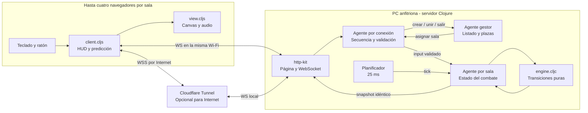
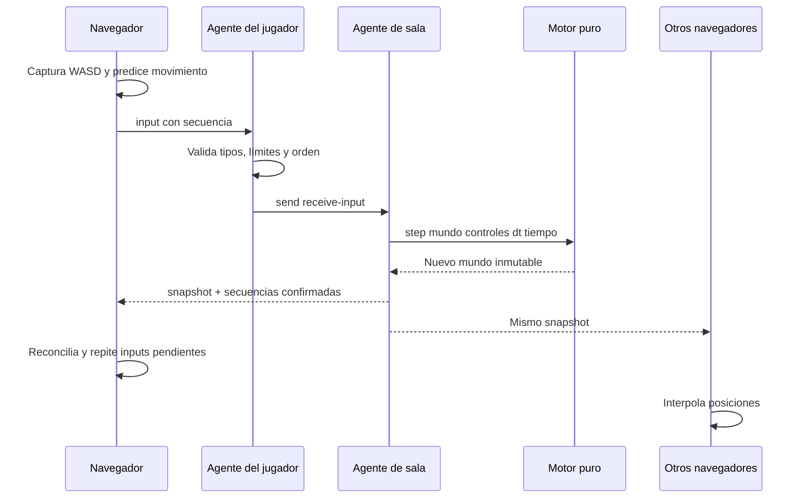

# Arquitectura y cumplimiento del trabajo final

## Objetivo de la entrega

**Clojure Arena** es una arena PvP: hasta cuatro jugadores compiten por eliminaciones en rondas de tres minutos. Una PC hospeda hasta cinco salas. El entrenamiento funciona en el navegador con el mismo motor de reglas, usando tres sentinelas.

El enunciado del trabajo final, conservado fuera del repositorio, pide un lenguaje funcional, cuatro jugadores simultáneos, datos inmutables, funciones puras, agentes/actores, mensajes y visualización en tiempo real. También solicita código con instrucciones y un informe con diagrama, concurrencia y principales funciones.

## Correspondencia verificable

| Requisito del PDF | Implementación | Evidencia / cómo mostrarlo |
|---|---|---|
| Mínimo 4 jugadores simultáneos | Cuatro plazas por sala | `bb test-network`: cinco salas con cuatro clientes cada una; repetir con cuatro PCs en la exposición |
| Lenguaje funcional Clojure | `.clj`, `.cljc` y `.cljs` | La lógica de aplicación se escribe en la familia Clojure; el navegador ejecuta JavaScript compilado |
| Datos inmutables | Mapas, vectores y conjuntos persistentes | `engine/player`, `engine/world`, `assoc-in`, `update`, `reduce`; prueba que conserva el mapa anterior |
| Funciones puras | Núcleo sin DOM, red, reloj global ni aleatoriedad | `engine/step` recibe mundo, controles, delta y tiempo; repetición produce el mismo resultado |
| Servidor sincronizado | Estado autoritativo por sala | Una única transición de daño/puntuación y una misma instantánea para los cuatro clientes |
| Agente por jugador | `server/connected` crea un agente individual | `player-message` conserva secuencia y límites, valida y envía controles |
| Agente para bucle principal | Un agente por sala | `tick-room` procesa el mundo serialmente; planificador manda mensajes cada 25 ms |
| Paso de mensajes | EDN sobre WebSocket y `send` entre agentes | `:create`, `:join`, `:input`, `:snapshot`, `:leave`, `:start` |
| Posiciones/acciones en tiempo real | Simulación a 40 Hz, instantáneas hasta 20 Hz y Canvas con RAF | Dos ventanas muestran movimiento, tiros y poderes de los demás |
| HTML/Canvas vía WebSocket permitido | Cliente web y mismo origen HTTP/WS | Página y `/ws` servidos en el puerto 8080 |
| Fuente e instrucciones | `README.md`, `bb.edn`, `deps.edn`, pruebas | Arrancar con `bb serve`; compilar con `bb build` |
| Diagrama y concurrencia | Este documento | Diagrama y secuencia debajo |
| Principales funciones | Este documento y guía de teoría | Tabla de funciones y ejemplos ejecutables |

**Precisión sobre el lenguaje:** ClojureScript es la variante para JavaScript; no ejecuta Clojure JVM dentro del navegador. Los agentes se implementan en el servidor Clojure. HTML y CSS son presentación. El QR usa una biblioteca MIT externa; no contiene lógica del juego. Esta separación debe explicarse durante la defensa, no ocultarse llamando `.clj` a un archivo JavaScript.

## Diagrama de componentes



Una partida no depende de quién la esté viendo. Todos reciben el estado calculado por la PC anfitriona. La cámara, partículas, sonido y transiciones del HUD son locales y no se envían por la red.

## Secuencia de un movimiento



## Concurrencia y consistencia

1. **Gestor:** un agente serializa creación, plazas y cambios de sala. Guarda IDs y referencias a agentes; no calcula colisiones.
2. **Jugador:** cada conexión tiene un agente que procesa su buzón. Conserva el ID y última secuencia, limita frecuencia y descarta entradas inválidas. Envía controles al agente de su sala.
3. **Sala:** contiene el agregado del combate (jugadores, balas, pickups, puntuaciones). Movimiento, colisión y daño se calculan en una misma transición. No hay dos escritores modificando simultáneamente su mundo.
4. **Planificador:** un `future` envía ticks, sin modificar directamente el mundo. Un conjunto atómico evita acumular más de un tick pendiente por sala. El delta se divide en pasos de como máximo 25 ms.
5. **Salida:** http-kit envía sin bloquear una instantánea a todos los miembros. Envío máximo aproximado: 20 veces/s por sala. El render usa `requestAnimationFrame`, independiente de esa frecuencia.

Los agentes usan un pool de hilos; **no existe un hilo de sistema exclusivo por jugador**. El orden entre clientes diferentes puede intercalarse. Por eso no se promete determinismo global de la red: lo determinista es una transición con el mismo estado, entradas y tiempo. Dentro de un agente las acciones se ejecutan de una en una.

El estado de combate de un jugador vive en el agregado de su sala. Su agente individual maneja sesión y mensajes. Esto permite decidir un impacto entre dos jugadores de forma coherente, sin necesitar coordinar dos estados de vida separados mediante locks.

## Protocolo resumido

EDN es un formato de datos de Clojure. Se usa `pr-str` para escribir y `clojure.edn/read-string` / `cljs.reader/read-string` para leer. No se usa `eval` para recibir mensajes.

```clojure
;; Cliente -> servidor
{:type :create :name "Ana" :skin "mora"
 :room-name "Equipo LP" :visibility :lan}

{:type :join :code "A1B2C3" :name "Luis" :skin "chispa"}

{:type :input :seq 25 :dx 1 :dy 0
 :ax 650 :ay 300 :fire true :actions [:dash]}

;; Servidor -> clientes de esa sala
{:type :snapshot :code "A1B2C3" :host "id-anfitrion"
 :world {...} :acks {"id-jugador" 25}}
```

Además del ping que mide latencia, el servidor envía `{:type :heartbeat}` cada dos segundos y el cliente responde al recibirlo. Esto evita depender exclusivamente de un temporizador del navegador en segundo plano. El agente del jugador registra la última actividad; el gestor elimina sesiones con más de 12 segundos sin respuesta usando `disconnected` y `detach`, igual que ante un cierre normal. El barrido da una detección habitual de 12–14 segundos; no distingue una red rota de una pestaña completamente suspendida.

En el navegador, un detector de ausencia de mensajes limpia la vista tras 12 segundos sin contacto y vuelve a conectar. Las instantáneas deben pertenecer al código de sala actual; los callbacks de un socket reemplazado se ignoran. Así un paquete atrasado no restaura jugadores de una sesión anterior.

El cliente transmite **intenciones**, no vida, daño, posición final ni bajas. El servidor fija los números válidos. Los IDs reales los crea el servidor. Las coordenadas de apuntado y direcciones se acotan; se limitan mensajes, plazas, salas, balas y eventos.

## Transporte LAN e Internet

- LAN: `http://IP:8080` y `ws://IP:8080/ws`.
- Internet: HTTPS/WSS sobre un túnel y HTTP/WS entre `cloudflared` y el servidor local.
- El cliente calcula `/ws` a partir del origen de la página. No lleva una IP de desarrollo escrita en el código.
- Una sala `:lan` solo acepta peticiones directas desde una dirección privada/local y sin cabeceras de proxy. Las peticiones del túnel se consideran Internet; no pueden ver o unirse a salas LAN.
- Este filtro está diseñado para **acceso directo + Cloudflare Tunnel**. Otro reverse proxy exige revisar `request-scope`; no conviene borrar las cabeceras del túnel.
- Todas las salas del enlace se ejecutan en la PC anfitriona. Cerrar el navegador del creador no apaga la PC servidor. El rol creador puede transferirse a otro miembro.

## Principales funciones

| Función | Entrada y salida | Papel |
|---|---|---|
| `world` / `player` | Parámetros -> mapa | Construcción del estado |
| `start-round` | Mundo y tiempo -> mundo | Reinicio coherente de todos los jugadores |
| `direction` | Componentes -> dirección normalizada | Evita ventaja diagonal |
| `move-player` | Jugador, input, delta, tiempo -> jugador | Movimiento y colisión con cobertura |
| `activate` | Mundo, ID, poder, input -> mundo | Valida recursos y aplica la habilidad |
| `damage-player` | Mundo, víctima, atacante, daño, fuente -> mundo | Dash, aparición, escudo, vida y bajas |
| `advance-shot` | Mundo, bala, delta -> mundo | Trayectoria y colisión por segmento |
| `resolve-ultimates` | Mundo -> mundo | Resuelve novas cuyo aviso terminó |
| `drop-item` / `collect-items` | Mundo -> mundo | Mejoras deterministas |
| `step` | Mundo, inputs, delta, tiempo -> mundo | Composición de una iteración |
| `player-message` | Estado de agente + mensaje -> estado | Frontera de validación por jugador |
| `command` | Gestor, ID, mensaje -> gestor | Salas y permisos de creador |
| `tick-room` | Sala, tiempo -> sala | Adaptador del bucle al agente |
| `predicted-player` | Jugador, input, delta, tiempo -> jugador | Respuesta inmediata y reconciliación visual |
| `view/draw!` | Estado de presentación -> efectos en Canvas | Dibujo; deliberadamente impura |

## Qué no se implementa

No se emplean P2P/WebRTC, rollback de combate, compensación de lag del servidor, base de datos, cuentas, balanceo entre PCs ni migración del anfitrión. La predicción local se limita a movimiento y dash. Las otras habilidades, impactos y bajas se confirman en el servidor. El juego está pensado para LAN y demostraciones pequeñas por túnel; una latencia alta seguirá notándose al disparar.

## Presentación suave sin autoridad en el cliente

`presentation.cljc` recibe mapas inmutables y devuelve copias destinadas exclusivamente al dibujo. `remember` guarda hasta ocho instantáneas y `sample` interpola su posición con un cursor aproximadamente 100 ms atrasado. `sample` conserva recursos y membresía del mundo más reciente: no puede restaurar jugadores desconectados, muertos o balas retiradas por un impacto. `engine.cljc` añade el origen del disparo a sus datos de presentación sin cambiar su colisión.

El jugador local usa predicción y una fracción visual del siguiente paso. Los efectos tienen reloj local; la estimación visual de tiempos de habilidades suaviza correcciones pequeñas. Ninguno de estos valores se escribe en el estado autoritativo ni se envía como resultado al servidor. En entrenamiento, el navegador sí ejecuta el motor completo, porque no hay una partida compartida.

## Selección de escenario

`engine/arenas` es un mapa inmutable de tres diseños con `:obstacles`, `:spawns` y `:drops`. `engine/world` valida el identificador y lo guarda en `:arena`; `start-round` lo conserva. El servidor recibe `:arena` solo al crear una sala, publica la elección en la lista de salas y snapshots y usa `blocked?` para movimiento y trayectoria de balas. El cliente dibuja ese mismo conjunto de rectángulos y cambia la caché estática de Canvas al cambiar de mapa. Los atlas de terceros se usan solo para presentación: nunca deciden colisiones ni daño.
